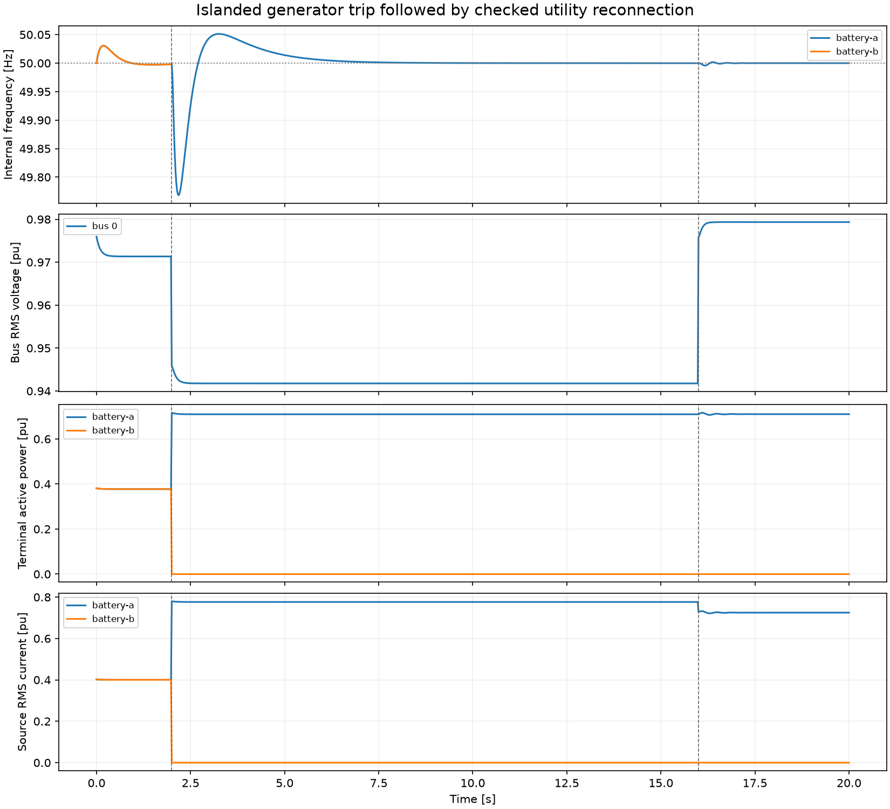
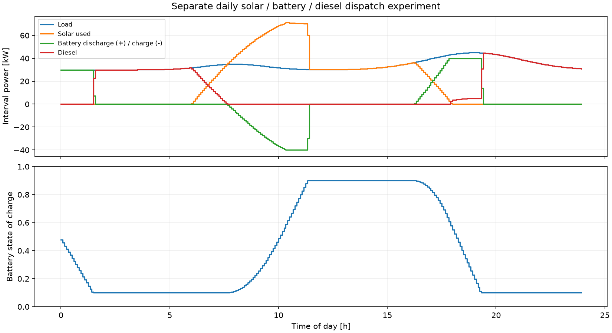

# Grid-forming Microgrid Lab

[](https://github.com/VictorOdoyo/gridforming-microgrid-lab/actions/workflows/ci.yml)
[](LICENSE)

A Python engineering laboratory for inverter-dominated microgrids: **droop and
virtual synchronous machine control, black start, load sharing, generator loss,
frequency restoration, and checked utility reconnection**.

The main model couples balanced RMS phasor networks to reduced outer-loop
dynamics. Separate electrical-component and daily-energy experiments cover
battery storage, PV availability, converter/filter behavior, and dispatch.



At 2 s, one of two islanded sources trips. The surviving VSM picks up the load,
secondary control restores frequency, and coordinated phase alignment permits
utility reconnection at 16 s. Disconnected-source oscillator states are excluded
from frequency metrics and plots.

## Run an experiment

Requires Python 3.11 or newer.

```sh
python -m pip install -e ".[dev]"
gridlab list
gridlab run --case island-recovery --mode vsm --output outputs/recovery
```

Open **outputs/recovery/index.html** for the report. Each run saves PNG/SVG figures,
CSV telemetry, a compressed NumPy trace, the exact case, metrics, solver settings,
dependency versions, Git provenance when available, and SHA-256 file checksums.

For locked dependencies, use `uv sync --locked --extra dev`, then prefix commands
with `uv run`. Python module execution also works: `python -m gridlab list`.

## Experiments

| Case | Engineering question |
| --- | --- |
| `load-step` | How do identical sources share a 50% impedance-load increase? |
| `secondary-restoration` | How does a bounded integral bias remove primary frequency offset? |
| `generator-trip` | Can the surviving source pick up generation and restore frequency? |
| `black-start` | Can a dead bus energize and pick up staged loads? |
| `island-recovery` | Can an island recover and satisfy guarded reconnection criteria? |
| `radial-feeder` | How do unequal ratings and feeder impedances affect sharing? |
| `overload` | How does a current ceiling trade delivered power against bus voltage? |

```sh
gridlab compare --output outputs/comparison
gridlab run --config examples/custom-island.toml --output outputs/custom
gridlab export-case --case radial-feeder --output outputs/feeder.json
gridlab inspect outputs/recovery/trace.npz
```

## Analysis with evidence

- AC load flow, ZIP operating points, Norton networks, transformer taps, Kron
  reduction, branch flows, and independent complex-power accounting.
- Rotating-frame equilibria, numerical linearization, gauge removal, eigenmodes,
  participation factors, frequency response, and Lyapunov certificates.
- Filter-lag/inertia stability maps, parameter sensitivity, bounded uncertainty,
  and integration convergence on matching physical observation times.
- Connection-aware frequency nadir and RoCoF, voltage excursions, energy,
  settling time, and algebraic KCL residuals.

A useful finding from the benchmark: a symmetric VSM simulation can conceal an
unstable relative mode. The tests retain a deliberately unstable 50 ms power
filter and verify that the 20 ms default is stable under both eigenvalue analysis
and an asymmetric angle perturbation. [Read the experiment](docs/experiments/vsm-stability.md).

```sh
gridlab stability --case load-step --mode vsm
gridlab study stability-map --output outputs/stability-map.json
gridlab study weak-grid --output outputs/weak-grid.json
gridlab study robustness --count 20 --seed 42 --output outputs/robustness.json
gridlab study convergence --output outputs/convergence.json
gridlab study daily-energy --output outputs/daily-energy.json
```

## Reference measurements

These are illustrative simulation results, sampled every 20 ms. They are not
hardware measurements or field-performance guarantees.

| Experiment | Frequency nadir | Maximum sampled absolute RoCoF | Final maximum frequency error |
| --- | ---: | ---: | ---: |
| Load step, droop | 49.8502 Hz | 5.4991 Hz/s | 0.1491 Hz |
| Load step, VSM | 49.8509 Hz | 1.3230 Hz/s | 0.1491 Hz |
| Island recovery, VSM | 49.7682 Hz | 2.3952 Hz/s | below 0.0001 Hz |

The separate daily-energy experiment serves 816.75 kWh of demand with 440.32 kWh
of utilized solar and 340.69 kWh of diesel generation. Battery SOC starts at 50%
and ends at 10%; the remaining energy comes from net battery discharge, with
charging/discharging losses accounted for.



Regenerate the figures and full-precision metrics:

```sh
python examples/reproduce_gallery.py
```

[Recorded measurements and provenance](docs/results/measurements.json)

## Verification and scope

The test suite checks analytical circuit solutions, energy conservation,
transformation identities, KCL, controller equilibria, asymmetric stability,
event boundaries, unsafe-reclose rejection, and report round trips.

```sh
python -m pytest -q
ruff check src tests examples
ruff format --check src tests examples
python -m build
```

CI tests Linux and Windows on Python 3.11 and 3.13, checks source quality, and
executes an installed wheel outside the checkout.

The AC solver is a balanced fundamental-frequency model with impedance loads and
an optional algebraic current limiter. Independent component experiments are
not integrated DC-side or inner-loop constraints. It does not calculate switching
harmonics, unbalanced faults, or certified protection behavior.

## Documentation

- [Model equations, units and signs](docs/model.md)
- [Usage, custom cases and study commands](docs/usage.md)
- [Validation evidence and interpretation](docs/validation.md)
- [Architecture, limitations and extension paths](docs/architecture.md)
- [Primary research and numerical references](docs/references.md)
- [Contribution guide](CONTRIBUTING.md)

Released under the [MIT license](LICENSE).
