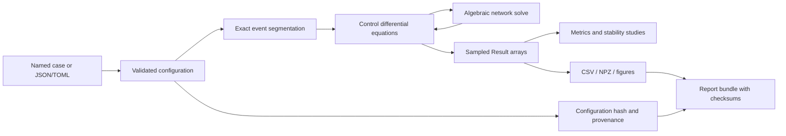

# Architecture and extension guide

The package has four related modeling layers.

1. Balanced phasor dynamics: config, network, norton, limited_network, dynamics,
   simulation, events, cases.
2. Coupled physical models: dc/ holds battery, DC/DC and DC link dynamics;
   converter/ holds SI dq plants and digital controls; hybrid/ connects their
   instantaneous power flow. lab/ supplies portable cases, studies and reports.
3. Independent electrical components and slow energy dispatch: battery, thevenin,
   solar, diesel, dclink, rlfilter, lcl, modulation, thermal, dispatch, daily_energy.
4. Engineering analysis and reproducibility: operating_point, linearize, stability,
   modes, participation, sensitivity, uncertainty, convergence, summary, storage,
   config_io, provenance, plotting, report and CLI.

## Data flow

Configuration objects are frozen dataclasses. Each continuous event segment owns
its network and source mask. An ODE callback never mutates event state, relay
timers or battery state; rejected/adaptive integration steps therefore do not
accidentally advance discrete equipment.

## Adding a controller

Implement and analytically test its equations first. Add explicit state meanings
and units, then integrate them into Dynamics. Update operating-point constraints
and inactive-state elimination. Test an asymmetric perturbation as well as
symmetric sharing. Check both mode stability and nonlinear trajectories.

## Adding an event

Define its target, allowed values and ordering semantics. Apply it only at a
segment boundary. Record the changed status where needed. Test non-grid-aligned
event time, time zero, simultaneous events, and an event at the final time.

## Limitations that affect interpretation

- The AC dynamic model is balanced, positive sequence and fundamental frequency.
- Dynamic load demand is constant impedance. ZIP/PQ operating-point experiments
  are separate; they are not silently substituted into dynamic cases.
- Current limiting is algebraic radial saturation.
- Utility voltage has fixed magnitude and nominal frequency.
- Source DC availability, SOC and thermal states do not constrain AC cases.
- There is no PWM switching, harmonic production, fault arc, insulation model,
  negative sequence, detailed protection coordination or hardware interface.
- Synchronization tests are illustrative engineering criteria.
- The solver fails on singular unreferenced islands; inspect topology first.

The physical layer has integrated battery SOC, polarization, DC link energy,
converter losses, AC inner loops and selected protection behavior. These are
not automatically added to the separate multi-bus phasor solver. See
[physical-model.md](physical-model.md) for the coupled model's equations and
[physical-validation.md](physical-validation.md) for its independent evidence.

## Further engineering work

Further work includes multi-inverter physical networks, unbalanced EMT models,
device-specific saturation recovery, detailed communication/protection networks,
independent EMT cross-validation and measured hardware parameter identification.
The physical LC and sampled-delay models provide starting points rather than
evidence that these broader problems have already been solved.
